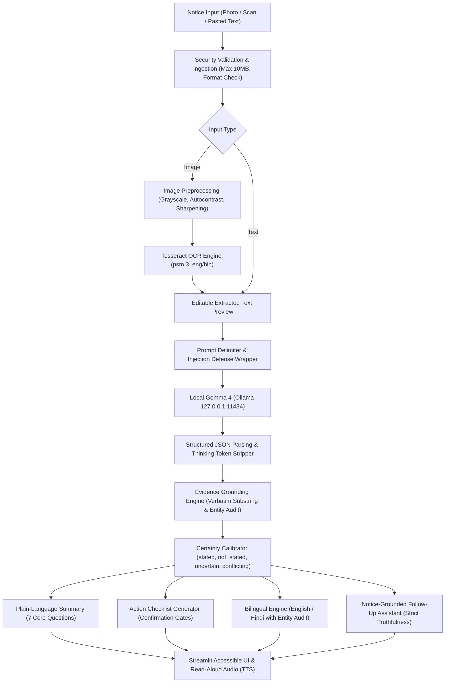

# SuchnaSetu AI — Architecture & Design Document

**Problem Statement:** PS02 — Notice-to-Action Accessibility Assistant  
**Event:** Hacktoberfest 2026 HackDay@Meerut × E-Cell IIMT University  
**Track:** Best Use of Gemma 4  
**Project Location:** `.`  

---

## 1. Executive Architecture Overview

SuchnaSetu AI transforms dense, complex, or image-based campus circulars, scholarship notifications, and government announcements into **evidence-grounded, plain-language action checklists**.

The architecture is built on six foundational engineering pillars:
1. **Local-First & Zero-Cost:** Powered entirely by a local instance of Google's **Gemma 4** (`gemma4:latest`) via Ollama and local **Tesseract OCR v5.4.0**, eliminating cloud costs, API key requirements, and network dependencies.
2. **Strict Evidence Grounding:** Anti-hallucination engine verifies that every single extracted fact (date, fee, eligibility rule, document) is backed by a verbatim quotation and line location from the source text.
3. **Transparent Uncertainty Gates:** If a detail is provisional ("tentative", "subject to change", "TBD"), conflicting, or missing, it requires explicit user verification before becoming an actionable checklist task.
4. **Accessible Multilingual Support:** First-class English and Hindi outputs with entity preservation auditing (dates and amounts remain strictly intact) plus dual-mode TTS (server-side MP3 and client-side Web Speech API).
5. **Session Isolation & Privacy:** Untrusted notices are treated as passive data within strict isolation boundaries; no data leaves the local machine.
6. **Single-Command Windows Experience:** Tailored for Windows PowerShell with automated preflight diagnostics and zero-friction setup.

---

## 2. End-to-End Pipeline Architecture

---

## 3. Core Component Breakdown

| Module | File Location | Responsibility |
|---|---|---|
| **Config & Diagnostics** | `src/notice2action/config.py` | Detects Windows paths for Tesseract, Ollama server status, installed models, and runs preflight checks. |
| **Strict Data Schemas** | `src/notice2action/schemas.py` | Pydantic v2 data models defining `ExtractedFact`, `CertaintyStatus`, `StructuredNotice`, `PlainLanguageSummary`, `ChecklistItem`, and `FollowUpAnswer`. |
| **Security & Ingestion** | `src/notice2action/security.py`, `ingestion.py` | Validates file types, sanitizes raw text, protects against decompression bombs, and wraps untrusted input in injection-proof delimiters. |
| **OCR Pipeline** | `src/notice2action/ocr.py` | Image enhancement (upscaling low-res notices, autocontrast stretch), Tesseract layout preservation, confidence score computation. |
| **Ollama Model Adapter** | `src/notice2action/llm/ollama_client.py` | Manages local inference with `gemma4:latest`, JSON-mode enforcement, `<thinking>` tag stripping, and timeout resilience. |
| **Evidence Grounding** | `src/notice2action/grounding.py` | Validates every evidence quotation against the raw source text. Detects altered numbers/dates, tentative markers, and missing fields. |
| **Notice Analysis** | `src/notice2action/analysis.py` | Orchestrates Gemma 4 structured extraction and passes model output through the deterministic grounding engine. |
| **Plain-Language Summary** | `src/notice2action/summary.py` | Synthesizes simple, readable answers to the 7 core user questions. |
| **Action Checklist** | `src/notice2action/checklist.py` | Converts verified facts into an ordered, categorized, interactive checklist with confirmation gating. |
| **Translation Engine** | `src/notice2action/translation.py` | Translates summaries and checklists into Hindi while guaranteeing zero alteration of dates, amounts, and contact details. |
| **Follow-Up Q&A** | `src/notice2action/followup.py` | Answers clarification questions strictly from notice text. If absent, truthfully states the information is missing. |
| **Audio Accessibility** | `src/notice2action/tts.py` | Dual-mode TTS: MP3 audio generation via `gTTS` and client-side browser Web Speech API for offline access. |
| **User Interface** | `app.py`, `src/notice2action/ui/components.py` | Streamlit interactive web application with high-contrast accessibility styling, fact cards, and live diagnostics. |

---

## 4. OCR-First vs. Vision-First Architectural Decision

During Phase 1, we verified that the local Ollama `gemma4:latest` model accepts vision inputs. However, we selected an **OCR-First Pipeline with Tesseract** as the primary architecture for three vital reasons:

1. **Human-in-the-Loop Verification (Feature A):** The official requirements mandate that users must be able to view and correct OCR errors before passing the text to semantic interpretation. A direct end-to-end vision model produces opaque outputs where the user cannot inspect what text was actually recognized.
2. **Deterministic Evidence Grounding (Feature D):** Grounding requires exact quotation and line-number referencing. Text extraction provides character offsets and line numbers (`Line 4-5`), enabling exact substring audits.
3. **Inference Latency & VRAM Efficiency:** High-resolution notice images take significant compute to tokenize in vision encoders (~11 seconds per image on laptop GPU). Tesseract preprocesses and extracts text in under 0.8 seconds on CPU, leaving 100% of GPU VRAM free for fast Gemma 4 reasoning and JSON generation.

---

## 5. Evidence Grounding & Anti-Hallucination Design

The grounding engine (`grounding.py`) enforces strict verification rules:
- **Verbatim Substring Matching:** The claimed `evidence_quote` must exist in the source notice text. If not found, the fact is automatically downgraded to `uncertain` and flagged with `"Quoted evidence not found in source text."`
- **Critical Entity Audit:** Dates, years, amounts (e.g. ₹500), and percentages (e.g. 75%) in the extracted fact are verified against the source text. If a number or date was altered, status becomes `conflicting`.
- **Tentative Detail Detection:** Phrases like "tentative", "provisional", "subject to change", "TBD" trigger `requires_confirmation = True`.
- **Absent Fields:** Missing details are strictly assigned `Not stated in the notice.` and catalogued in `missing_information`.
