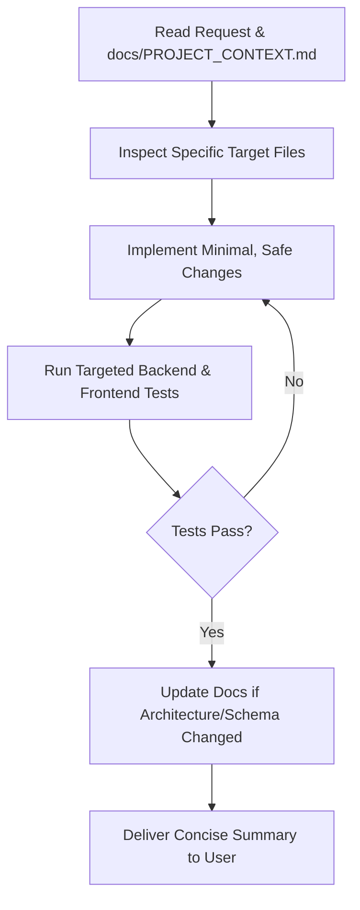

# SochnaSetu AI — Development Workflow & Guidelines for Antigravity (AGY)

> **Purpose:** Guidelines and rules for AI assistants (Antigravity/AGY) and developers modifying SochnaSetu AI. Follow these procedures to maintain software reliability, data persistence, and development velocity.

---

## 1. Core Principles

1. **Context First, No Redundant Audits:**
   - Before executing tasks, consult `docs/PROJECT_CONTEXT.md` for architecture, schema definitions, route specifications, and test commands.
   - Do NOT perform expensive, exhaustive project-wide tree audits or grep sweeps on every new task. Target only the specific files relevant to the issue.

2. **SQLite is the Canonical Database:**
   - SochnaSetu AI strictly uses **SQLite** with Write-Ahead Logging (`WAL`).
   - Under no circumstances replace SQLite with PostgreSQL, MySQL, Supabase, or external DBs unless explicitly directed by the repository owner.
   - Always test database migrations and connection lifecycles with SQLite WAL concurrency in mind (`PRAGMA busy_timeout = 30000;`).

3. **User Isolation & Guest Experience:**
   - Endpoints serving user dashboard resources must use `get_current_user_or_guest`.
   - Never turn a legitimate `HTTP 401 Unauthorized` on `/api/auth/me` into `HTTP 200` to suppress logs: 401 correctly informs frontend state that the visitor is unauthenticated.
   - Always ensure registered user records (`user_id = "<uuid>"`) are filtered and isolated from guest records (`user_id = "guest_..."`).

4. **Security by Default:**
   - Passwords must always be hashed with Argon2id (`argon2-cffi`). Plaintext passwords or weak hashing algorithms (MD5/SHA1) are strictly prohibited.
   - Authentication tokens must be stored as SHA-256 hashes in `auth_tokens`.
   - Never expose token hashes, password hashes, or API secrets in logs, frontend responses, or client-side storage.

5. **Smallest Safe Changes:**
   - Implement targeted modifications. Do not refactor unrelated subsystems or delete existing working features.
   - Maintain documentation integrity: update `docs/PROJECT_CONTEXT.md` whenever database schemas or API contracts change.

---

## 2. Standard Task Lifecycle



### Step 1: Reference Context
Read `docs/PROJECT_CONTEXT.md` to identify the relevant components, routes, database tables, and verification commands.

### Step 2: Make Targeted Changes
- Backend changes: `src/notice2action/`
- Frontend components: `frontend/src/components/` or `frontend/src/views/`
- API client: `frontend/src/services/apiClient.ts`
- Database migrations: `src/notice2action/storage/db.py`

### Step 3: Run Verification Suites
Always verify changes locally before completing a task:
```bash
# Verify backend functionality
.\.venv\Scripts\python.exe -m pytest tests/test_backend_persisted_auth.py

# Verify frontend types and build
npm --prefix frontend run build
```

---

## 3. Database Migration Protocol

When adding new tables or columns:
1. Always back up the SQLite database first:
   ```bash
   # Online backup to data/backups/
   python -c "import sqlite3, time; s = sqlite3.connect('data/suchnasetu.db'); b = sqlite3.connect(f'data/backups/suchnasetu_backup_{int(time.time())}.db'); s.backup(b); b.close(); s.close()"
   ```
2. Add migration SQL to `src/notice2action/storage/db.py` under `SCHEMA_MIGRATIONS`.
3. Increment migration version number.
4. Verify idempotency: running migrations multiple times must not crash or duplicate columns.
