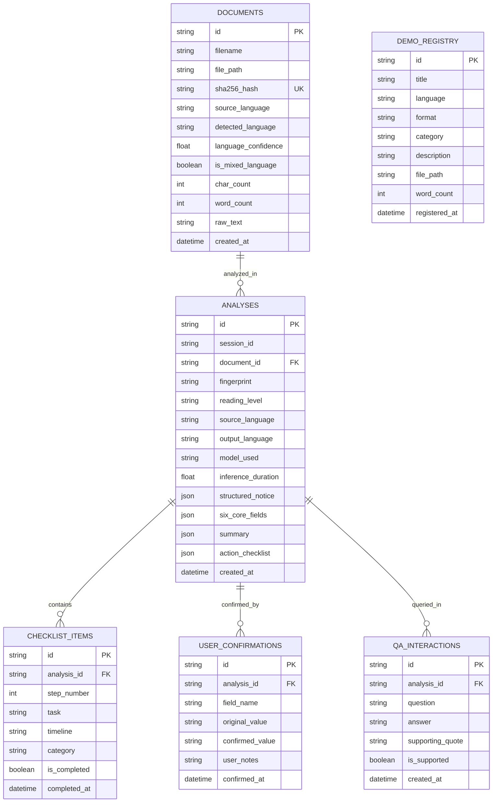

# Database and Storage Architecture Audit
**Project:** SochnaSetu AI — Notice-to-Action Accessibility Assistant  
**Problem Statement:** Hack Day 2026 — PS02  
**Timestamp:** 2026-10-24  
**Scope:** Architecture, schema definitions, write-ahead logging (WAL), indexing, file storage management, and data integrity in SQLite (`data/suchnasetu.db`).

---

## 1. Storage Architecture Overview

SochnaSetu AI has replaced ephemeral in-memory sessions with a production-grade, zero-configuration local SQLite 3 database (`data/suchnasetu.db`).

- **Engine:** Python built-in `sqlite3`
- **Concurrency Mode:** Write-Ahead Logging (`PRAGMA journal_mode=WAL;`)
- **Integrity Enforcements:** Foreign keys enabled (`PRAGMA foreign_keys=ON;`), synchronous normal (`PRAGMA synchronous=NORMAL;`), UTF-8 text encoding.
- **File Asset Storage:** Managed filesystem directory in `data/uploads/` storing original uploaded PDFs, Word documents, and high-resolution notice images.
- **Fixtures Directory:** `tests/fixtures/demo_library/` for canonical pre-indexed demo notices.

---

## 2. Table Schema Definitions (`src/notice2action/storage/db.py`)

---

## 3. Storage Performance & Indexing

To guarantee instant dashboard response times and low-latency search across large notice collections, indexes are defined on:
1. `idx_docs_hash`: Unique lookup by document SHA-256 checksum (prevents redundant re-inferences).
2. `idx_analyses_fp`: Fast retrieval by notice fingerprint.
3. `idx_checklist_status`: Quick aggregation of completed vs. pending tasks.
4. `idx_demo_lang_cat`: Instant multi-filter query execution on Demo Library (`language`, `format`, `category`).

---

## 4. Hot Backup & Disaster Recovery

The storage manager (`DatabaseManager.backup_database()`) implements an online SQLite backup routine:
- Uses `sqlite3.Connection.backup()` to create a consistent, non-blocking snapshot in `data/backups/`.
- Safe to execute while active write transactions and Ollama inference are occurring.
- Validated under Windows file locking constraints with clean connection teardowns.
